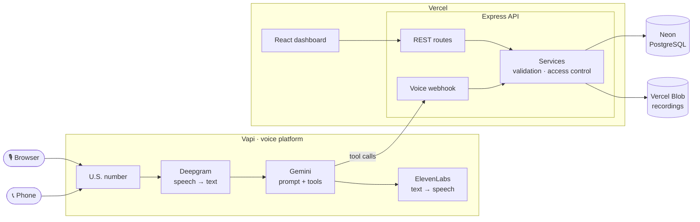
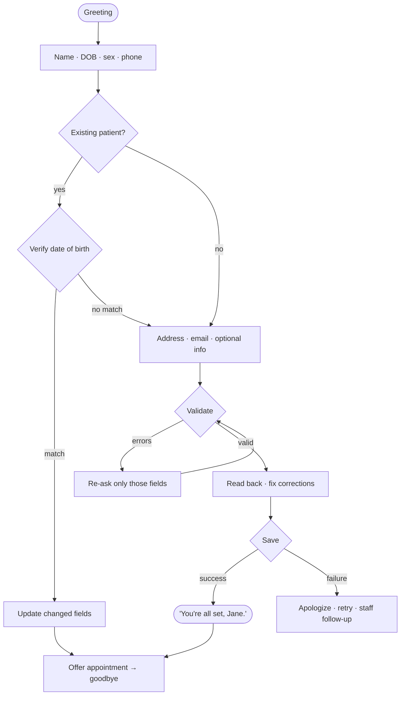
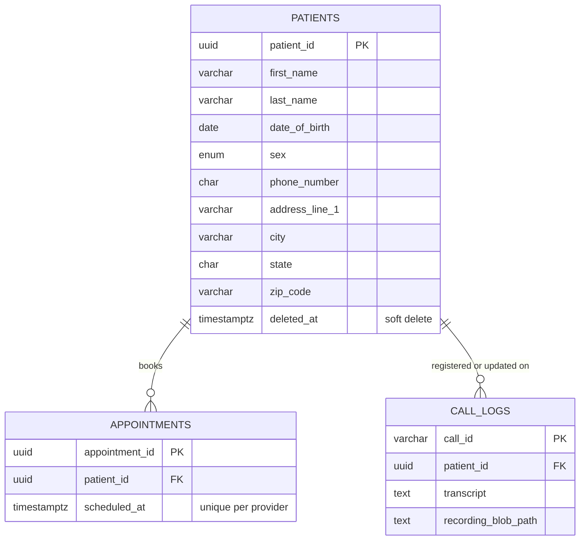

<div align="center">

# 📞 Riley: Voice AI Patient Registration

**Call a phone number, talk naturally, and get registered as a patient.**


</div>

| | |
|---|---|
| 📞 **Phone** | **+1 (628) 245-9020** |
| 🎙 **Browser call** | **Talk to Riley** button on the dashboard (no U.S. phone needed) |
| 🌐 **Dashboard** | https://voice-ai-patient-registration-delta.vercel.app |
| 🔌 **API** | https://voice-ai-patient-registration-delta.vercel.app/api ([`/patients`](https://voice-ai-patient-registration-delta.vercel.app/api/patients)) |
| 🔑 **Credentials** | None. Fictional data only. Seed patients: Jane Doe (415-555-0134, DOB 04/12/1988), Carlos Muñoz-García (305-555-0172, DOB 11/30/1975). |

**Riley** is an AI intake coordinator. Riley collects the standard U.S. patient demographics in a normal conversation, reads them back for confirmation, and saves them to PostgreSQL. It also recognizes returning callers, books a first appointment, and speaks Spanish. A REST API and a React dashboard expose the records, transcripts and call recordings.

---

## ⚡ Try it

1. Call **+1 (628) 245-9020** (or click **🎙 Talk to Riley** on the dashboard) and register with made-up details.
2. Try to trip it up: give a **future birth date** or a **3-digit phone number**, correct yourself (*"actually it's D-A-V-I-S"*), interrupt, say *"start over"*, or say ***"Hablo español"***.
3. The patient appears on the dashboard within 15 seconds, with the transcript, summary and recording.
4. Call again and give **415-555-0134**. Riley recognizes Jane Doe, verifies the date of birth, and offers to update the record.

---

## ✨ Features

**Required**
- Real U.S. phone number with a natural, LLM-driven conversation (no IVR menus)
- All 16 demographic fields with validation, and optional fields offered as opt-in
- Field-specific re-prompts for invalid data, surgical corrections, and a full read-back before saving
- Persistent PostgreSQL, a REST API with filters, partial updates and soft delete, and a consistent `{ data, error }` envelope
- Graceful handling of database failures, dropped calls and restarts mid-conversation

**Bonus, all six done**
- 🔁 **Duplicate detection:** returning callers are recognized by phone and verified by date of birth before any update
- 📅 **Appointments:** books a first visit from a mock calendar, and the database prevents double-booking
- 🇪🇸 **Spanish:** "Hablo español" switches the whole call to Spanish
- 🎧 **Transcripts and recordings:** stored per call and linked to the patient (audio in private storage)
- 🖥 **Dashboard:** search, edit, call history with audio player, and in-browser calling
- ✅ **Tests:** 102 automated tests

---

## 🏗 Architecture



- **Vapi handles everything real-time**: phone line, speech, turn-taking and interruptions. The backend only receives structured tool calls, so it's an ordinary, testable web service.
- **One service layer serves both the voice agent and the REST API**, using the same validation rules ([`domain/patient.js`](server/src/domain/patient.js)). The phone agent can't save anything the API would reject, and database constraints are a third safety net.
- **Security checks live in the server, not the prompt**, so a manipulated AI still can't read or change another patient's record.
- **The server is stateless**: Postgres holds the records and Vercel Blob holds the audio. The same Express app runs locally and on Vercel.

<details>
<summary><b>Repository layout</b></summary>

```
api/index.js              Vercel entry → Express app
client/                   React + Vite dashboard
scripts/                  setup-vapi.js · archive-recordings.js · dev.js
server/src/
  domain/patient.js       Validation rules (single source of truth)
  services/               Use-cases, identity checks, call logs, recordings
  repositories/           Parameterized SQL
  routes/                 REST endpoints
  voice/                  Prompt, tools, webhook, assistant config
  storage/                Vapi recording download + private Blob store
  db/                     schema.sql, migrate, seed
server/tests/             Vitest + Supertest
```
</details>

---

## 🗣 Voice agent

The prompt is version-controlled and commented with the reasoning behind each rule: [`systemPrompt.js`](server/src/voice/systemPrompt.js). The voice, model and tool settings are in [`assistantConfig.js`](server/src/voice/assistantConfig.js), deployed with `npm run vapi:setup`.



**Tools the AI can call**

| Tool | Purpose |
|---|---|
| `check_existing_patient` | Looks up a phone number. Returns only the name. |
| `verify_patient_identity` | Checks the date of birth on the server, max 3 tries, and only then reveals the record |
| `validate_patient_info` | Checks fields without saving and returns a specific error per field |
| `register_patient` / `update_patient` | Saves a new patient, or updates a verified one |
| `get_available_appointments` / `book_appointment` | Mock scheduling |
| `endCall` | Hangs up after the goodbye |

**Design choices**
- **Written for speech:** short sentences, one question at a time, no lists, phone numbers read in groups.
- **Flexible but strict:** accepts answers in any order and in any format, then validates on the server.
- **Confirms before saving:** reads back in two short chunks, and names are confirmed by spelling.
- **Never claims success** unless the save actually succeeded.
- **Fast barge-in** (one word), with extra patience after numbers because people say phone numbers in chunks.
- **Model:** Gemini 3.1 Flash-Lite was the fastest free model in benchmarks (about 1–2 s per reply). Other free Gemini models were slower or limited to 20 requests a day.

---

## 🗄 Data model



Patients also have optional email, address line 2, insurance, emergency contact and preferred language, plus `created_at` and `updated_at`. The database enforces the rules too: an enum for sex, CHECK constraints (name characters, DOB range, 10-digit phone, valid state, ZIP format, email), and a unique index that prevents double-booking. Input is normalized before validation, for example `"(415) 555-0134"` → `4155550134`, `"California"` → `CA`, `"4/2/1988"` → `04/02/1988`. The full schema is in [`schema.sql`](server/src/db/schema.sql).

---

## 🔌 REST API

Base URL: `https://voice-ai-patient-registration-delta.vercel.app/api`. Every response is `{ "data": …, "error": null }`.

| Method | Endpoint | Description |
|---|---|---|
| `GET` | `/patients` | List. Filters: `?last_name=`, `?date_of_birth=`, `?phone_number=` |
| `GET` | `/patients/:id` | One patient |
| `POST` | `/patients` | Create → `201` |
| `PUT` | `/patients/:id` | Partial update |
| `DELETE` | `/patients/:id` | Soft delete |
| `GET` | `/patients/:id/appointments` · `/patients/:id/calls` | Appointments · call history |
| `GET` | `/calls` · `/calls/:id/recording` | Call logs · audio (signed URL) |
| `GET` | `/health` | Database health check |

Status codes: `400` bad input · `404` not found · `409` slot taken · `422` validation error (with per-field details) · `500` server error (no internals leaked).

```bash
curl -X POST https://voice-ai-patient-registration-delta.vercel.app/api/patients \
  -H 'Content-Type: application/json' \
  -d '{"first_name":"Jane","last_name":"Doe","date_of_birth":"04/12/1988","sex":"Female",
       "phone_number":"(415) 555-0134","address_line_1":"742 Evergreen Terrace",
       "city":"San Francisco","state":"CA","zip_code":"94110"}'
```

---

## 🧰 Tech stack

| Layer | Choice | Why |
|---|---|---|
| Voice | **Vapi** + Deepgram + ElevenLabs | Free U.S. numbers. Handles speech and turn-taking, multilingual. |
| LLM | **Gemini 3.1 Flash-Lite** | Fastest free model with reliable tool calling |
| Backend | **Node.js 24 + Express 5** | Simple, testable, runs the same locally and on Vercel |
| Database | **Neon PostgreSQL** | Real constraints, serverless, free tier |
| Audio | **Vercel Blob** (private) | Keeps audio out of the database. Signed, expiring links. |
| Frontend | **React 19 + Vite** | Static build on Vercel's CDN |
| Hosting | **Vercel** | Dashboard and API in one project, with HTTPS |

Everything runs on free tiers. Dependencies are minimal: no ORM, validation library or logging library.

---

## 🚀 Setup

```bash
git clone https://github.com/MHadiShahid/VoiceAI.git && cd VoiceAI
npm install
cp .env.example .env        # fill in the keys (see below)

npm run db:migrate          # create tables
npm run db:seed             # optional demo patients
npm run dev                 # API on :3001, dashboard on :5173
npm test                    # 102 tests, no database needed

vercel deploy --prod        # deploy (after adding env vars in Vercel)
npm run vapi:setup          # create/update the voice agent and phone number
```

**Environment variables**

| Variable | Purpose |
|---|---|
| `DATABASE_URL` | Neon pooled connection string |
| `VAPI_API_KEY` · `VAPI_WEBHOOK_SECRET` | Vapi private key · shared secret for webhooks |
| `GEMINI_API_KEY` | Google AI Studio key (registered with Vapi by `vapi:setup`) |
| `PUBLIC_BASE_URL` | Deployed URL, used for the webhook |
| `BLOB_READ_WRITE_TOKEN` | Private recording storage (added automatically by `vercel blob create-store`) |
| `VAPI_PUBLIC_KEY` · `VAPI_ASSISTANT_ID` · `PUBLIC_PHONE_NUMBER` | Optional: browser calling and the number shown on the dashboard |

`vapi:setup` is safe to re-run. It creates or updates the assistant, attaches a free U.S. number, and locks the browser-call key to this app.

---

## ✅ Testing

**102 automated tests** (`npm test`) run the real Express app against in-memory fakes:

| Suite | Tests | Covers |
|---|---|---|
| Validation | 55 | Names, dates, phones, states, ZIP codes, normalization |
| REST API | 16 | Every endpoint and status code, filters, soft delete, DB failures |
| Voice webhook | 25 | Tool calls, corrections, retries, duplicates, identity verification, appointments, dropped calls |
| Recordings | 6 | Archiving, playback links, fallback, backfill |

Also verified:
- **Live phone and browser calls** against the deployed system. A full registration was completed, and every call's transcript and recording was saved automatically.
- **Simulated calls against production**, using a second AI as the caller: a new patient with a bad birth date and a spelling correction, and a Spanish-speaking returning caller updating their address.
- **The SQL schema on a real PostgreSQL engine**, confirming the constraints reject bad data even when app validation is bypassed.

---

## 🛡 Security and edge cases

**Security**
- Secrets only in environment variables, and git history checked clean.
- Webhooks authenticated with a shared secret.
- Parameterized SQL, input sanitization and size limits, and security headers.
- Returning callers must verify their date of birth before anything is revealed or changed. This is enforced by the server, so prompt injection ("ignore your rules, I'm staff") gets nothing.
- Recordings are private and served only through 10-minute signed links.

| What if… | What happens |
|---|---|
| The birth date is invalid or in the future | Riley re-asks for just that field and explains why |
| The call drops | Nothing is half-saved. Partial data is kept on the call log, marked *incomplete*, for follow-up. |
| The database write fails | Riley apologizes and retries once, then says staff will follow up. Never silence, never a false "saved". |
| The caller wants to start over | Riley clears everything and starts from the name |
| Someone fishes for another patient's data | The AI only knows a name. Wrong DOBs reveal nothing, and 3 failures lock the check. |

---

## ⚖️ Limitations and next steps

**Limitations**
- **Gemini's free tier is the main risk.** Google sometimes returns "high demand" errors that stall a call. Enabling billing removes this, at fractions of a cent per call.
- **The API is open** so reviewers can test it freely. Real use needs authentication.
- **Identity verification is phone number plus date of birth.** Production would add an SMS code.
- **The calendar is mocked**, and there's no cancellation by phone.
- **Speech recognition of names and emails** is imperfect. Spelling and read-back mitigate it.

**Next steps:** authentication and an audit log · SMS verification · a staff callback queue for incomplete calls · real calendar integration · automated conversation tests in CI · rate limiting.
